# CodeQuest `</>`

**A live, Kahoot-style quiz game built for K-12 coding classrooms.** Instructors build quizzes (or have AI draft them), host a game on the projector, and students join from any device with a 6-digit PIN to race for points that are saved to their accounts.

🔗 **Live demo:** _add your Vercel URL here_
🎓 **Demo logins:** `demo_student` · `demo_teacher` · `demo_admin` (password is shown on the login page; one click signs you in)

> Tip for reviewers: sign in as **demo_teacher** and open **Recent games → Report** to see a seeded class report. Then host *Python Basics Warm-Up* in one window and join it as **demo_student** in a private window.

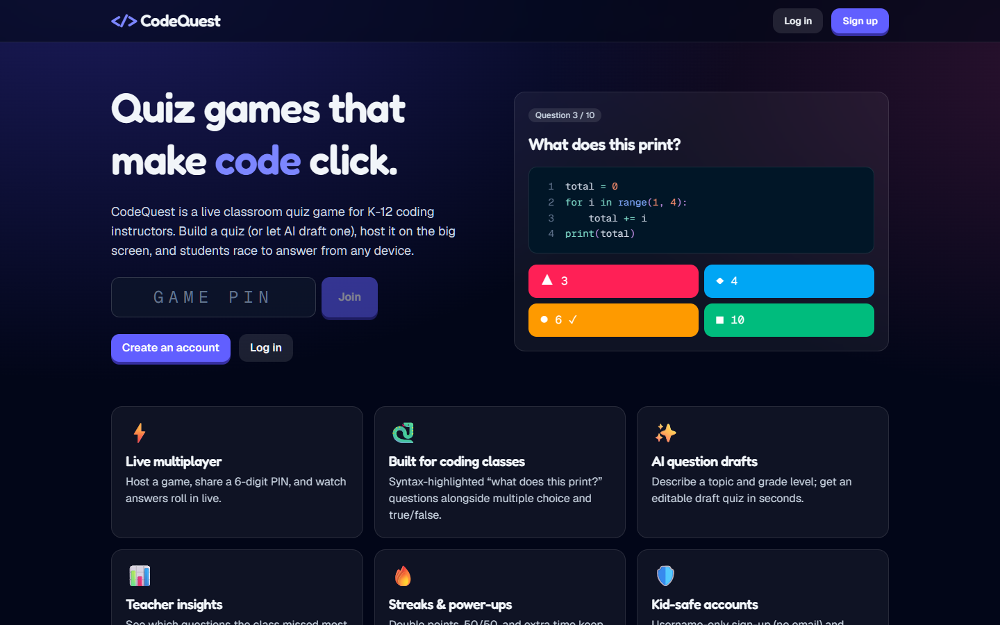

---

## Screenshots

### 🎮 Live quiz
The host screen goes on the classroom projector while students answer on their own devices. Both views stay in sync in real time.

<table>
  <tr>
    <th width="70%">Host (projector)</th>
    <th width="30%">Student (phone)</th>
  </tr>
  <tr>
    <td>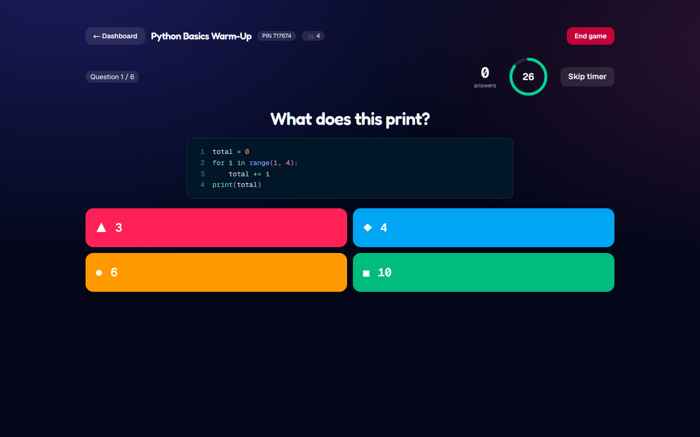</td>
    <td>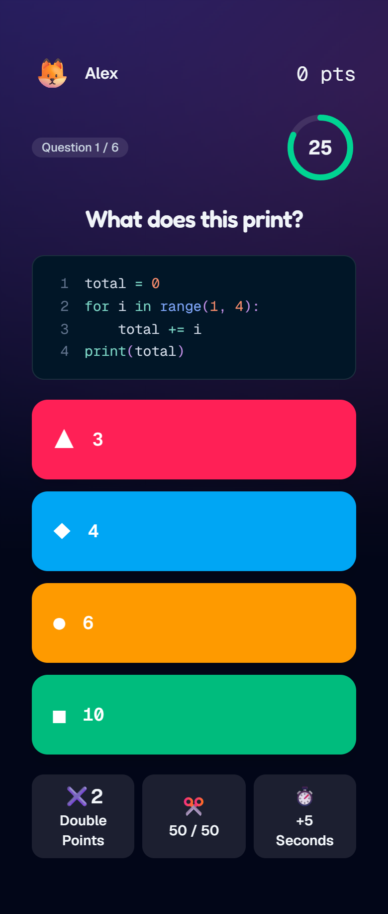</td>
  </tr>
  <tr>
    <td>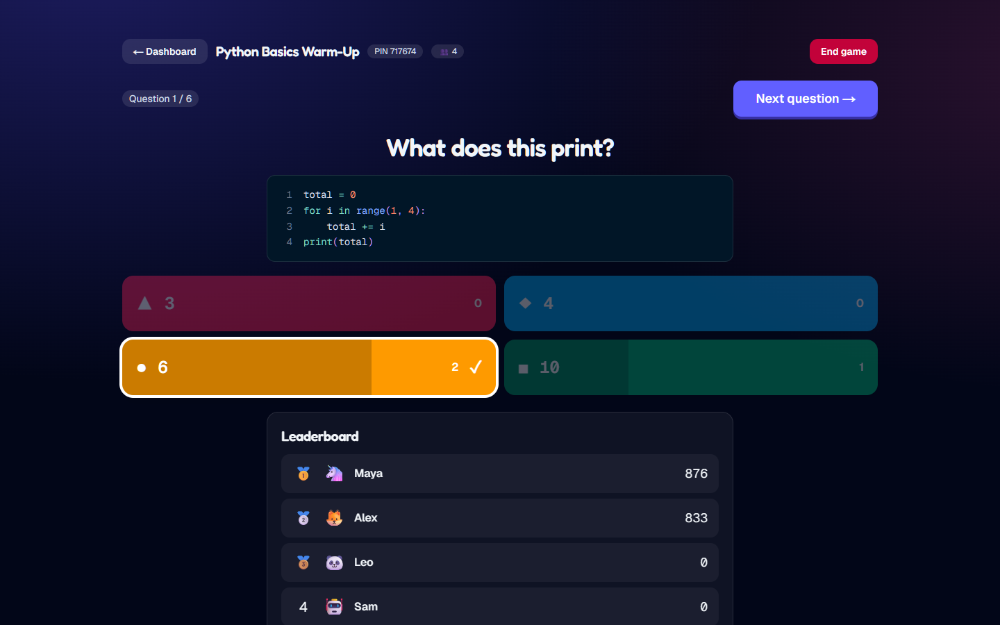</td>
    <td>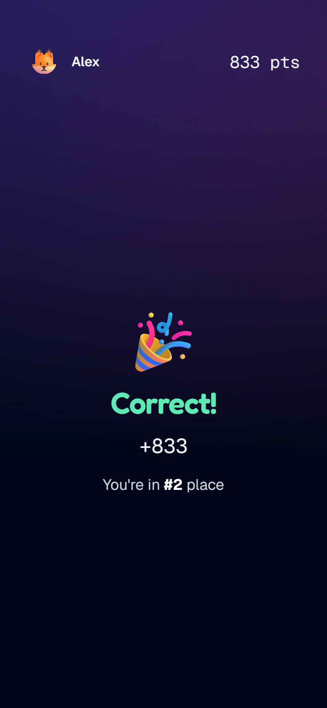</td>
  </tr>
</table>

<details>
<summary>Lobby and final podium</summary>

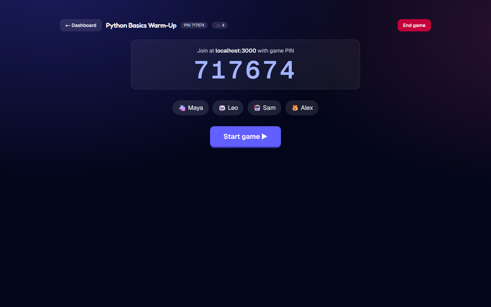
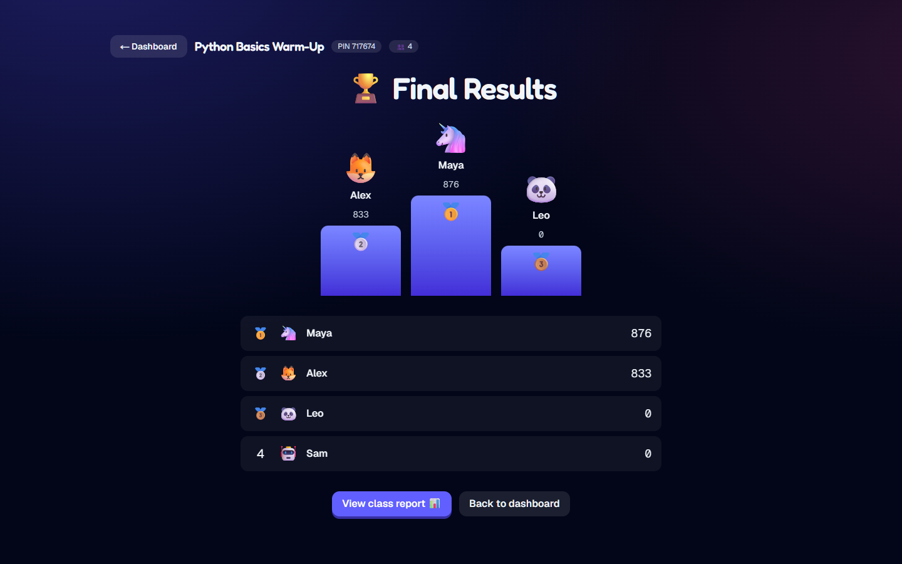

</details>

### 🛠️ Quiz maker
Instructors build quizzes with multiple-choice, true/false, and "what does this code print?" questions. The editor has a live syntax-highlighted preview, per-question timers and point values, and an AI draft panel.

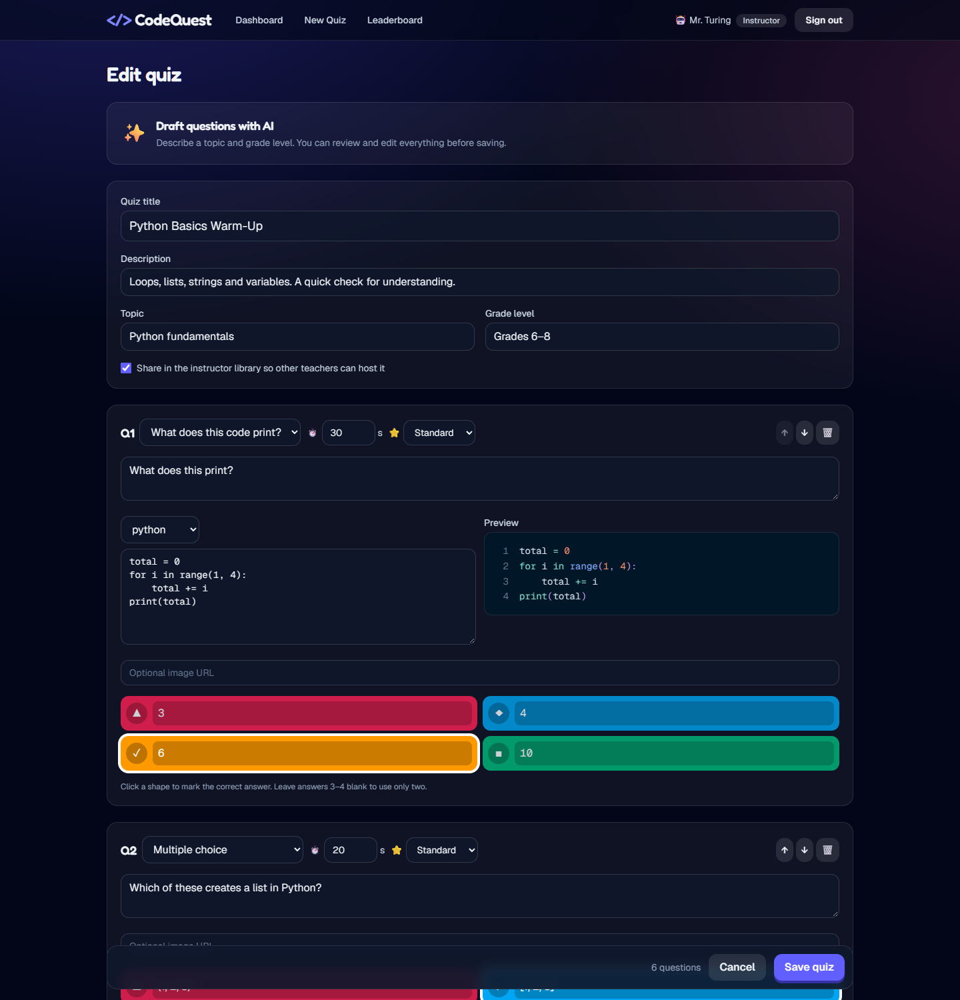

### 🏆 Leaderboard
Points from every game are saved to each student's account and add up over time.

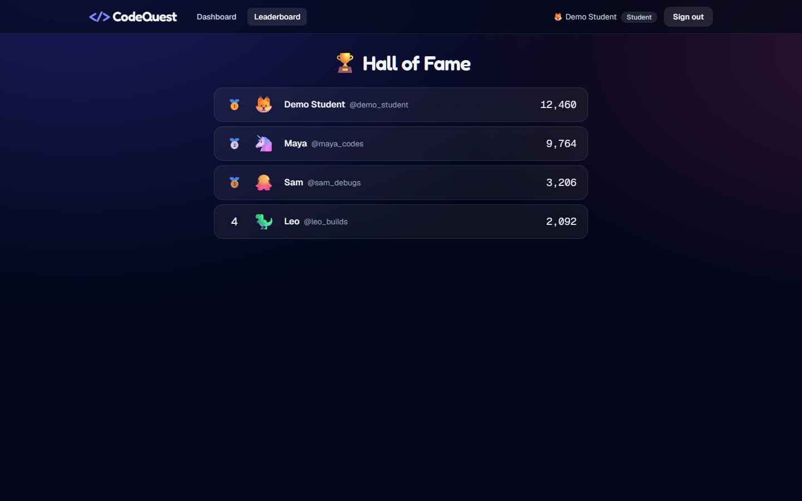

### 📊 Class report
After each game, instructors see class accuracy, the questions most worth reteaching, and a per-question breakdown.

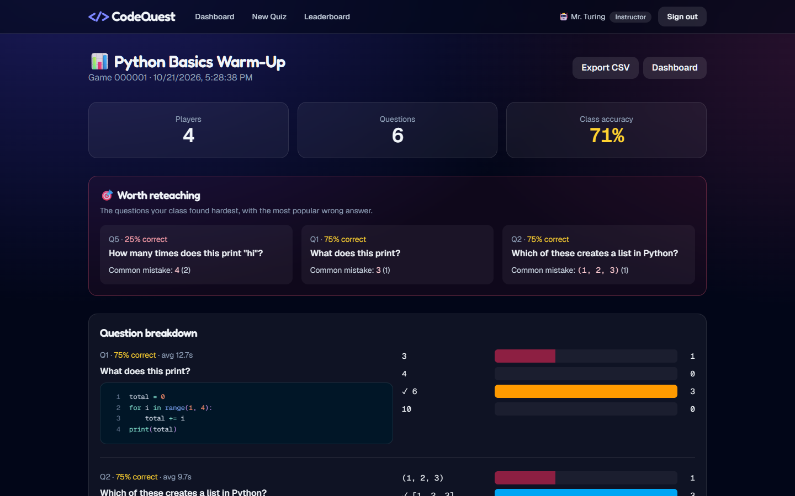

---

## Features

### Core requirements
| Requirement | How CodeQuest meets it |
|---|---|
| Student, instructor, and admin accounts | Supabase Auth plus a `profiles.role` column. Instructors sign up with an invite code. Admins manage roles in `/admin`. |
| Instructors create their own question sets | A full quiz builder with multiple-choice, true/false, and "what does this code print?" questions, per-question timers and point values, reordering, and a public/private toggle. |
| Host a live quiz that many students join and earn saved points | The host gets a PIN and a lobby. Questions and answers sync in real time across devices. Scoring is server-side and based on speed. Points are added to each student's lifetime total when the game ends. |
| Separate database | Supabase (Postgres) with row-level security |
| Reads and writes of documents/objects | Quizzes, questions, games, players, and answers, through 22 REST endpoints |
| Authenticated users | Username and password sessions through `@supabase/ssr`, with protected routes in `proxy.ts` |
| RESTful API endpoints used meaningfully | Every write and all game logic goes through `/api/*` (see the table below) |
| Deployed publicly | Vercel |

### Extras
- **🐍 Built for coding classes:** syntax-highlighted code questions (Python, JS, Java, …) with a live preview in the editor.
- **✨ AI question drafts:** an instructor enters a topic, grade level, and language, and Claude drafts an editable quiz. Nothing is saved until the instructor reviews it.
- **📊 Teacher analytics:** after each game the report shows class accuracy, a "worth reteaching" panel (the most-missed questions with the most common wrong answer), per-question answer distributions, per-student results, and CSV export.
- **🔥 Streaks and power-ups:** streak bonuses (+10% per correct answer in a row) plus three one-time power-ups: Double Points, 50/50, and +5 Seconds. All are enforced on the server.
- **🛡️ K-12-safe accounts:** students sign up with a **username only (no email)**, so the app collects minimal personal data from minors. Usernames, display names, and in-game nicknames go through a profanity filter, and hosts can remove players from the lobby.
- **🏆 Leaderboard** of lifetime points, plus a podium at the end of each game.

---

## Architecture

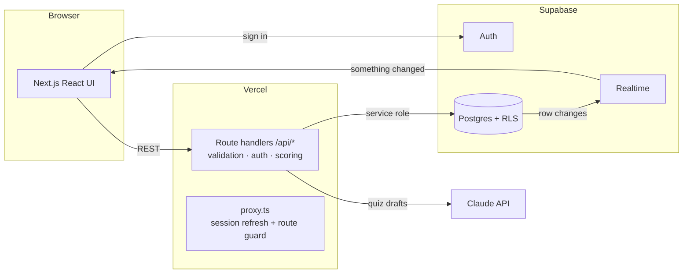

**Design decisions**
- **Clients never write to the database directly.** Every write goes through an API route that validates input with Zod, checks the caller's role, and then uses the service-role key. RLS policies allow browsers read access only, which is just enough for realtime subscriptions.
- **Answers stay secret.** Students can't read the `questions` table, which contains `correct_index`. The game API sends a sanitized question and includes the correct answer only after the host reveals it. Answer results are also held back until the reveal, so students can't tip each other off.
- **Realtime signals, REST decides.** Supabase Realtime only tells clients *that* something changed. Each client then calls `GET /api/games/:pin`, which returns a view tailored to that viewer (host or player). Bursts are coalesced, and a slow poll covers dropped sockets.
- **The server owns scoring and timing.** Response time is measured from the server's `question_started_at`. Clients adjust their countdown to the server clock, and late answers are rejected (with a small grace period for network latency).
- **Race-safe transitions.** Host actions update the game with a conditional on its current status and question index, so a double click can't skip a question or award points twice. A unique constraint guarantees one answer per player per question.

## REST API

| Method | Endpoint | Who | Purpose |
|---|---|---|---|
| `POST` | `/api/auth/signup` | anyone | Create a username/password account (instructors need the invite code) |
| `GET` | `/api/me` | signed in | Profile and recent game history |
| `PATCH` | `/api/me` | signed in | Update display name or avatar |
| `GET` | `/api/quizzes` | instructor/admin | Own quizzes plus the shared library (`?scope=mine`) |
| `POST` | `/api/quizzes` | instructor/admin | Create a quiz with its questions |
| `GET` | `/api/quizzes/:id` | owner/admin/public | A quiz with all of its questions |
| `PUT` | `/api/quizzes/:id` | owner/admin | Update a quiz (questions synced in place so past reports stay intact) |
| `DELETE` | `/api/quizzes/:id` | owner/admin | Delete a quiz |
| `POST` | `/api/quizzes/generate` | instructor/admin | AI-drafted questions (not saved) |
| `GET` | `/api/games` | instructor/admin | Games you've hosted |
| `POST` | `/api/games` | instructor/admin | Host a new game and get a PIN |
| `GET` | `/api/games/:pin` | signed in | Live game state for the caller |
| `PATCH` | `/api/games/:pin` | host | `start` · `reveal` · `next` · `end` |
| `POST` | `/api/games/:pin/players` | signed in | Join or rejoin a game |
| `DELETE` | `/api/games/:pin/players?id=` | host | Remove a player |
| `POST` | `/api/games/:pin/answers` | player | Submit an answer (scored on the server) |
| `POST` | `/api/games/:pin/powerups` | player | Activate a power-up |
| `GET` | `/api/games/:pin/report` | host/admin | Post-game analytics |
| `GET` | `/api/leaderboard` | signed in | Top students by lifetime points |
| `GET` | `/api/admin/users` | admin | List and search users |
| `PATCH` | `/api/admin/users/:id` | admin | Change role or name, reset points |
| `DELETE` | `/api/admin/users/:id` | admin | Delete an account |

## Data model

`profiles` (role, avatar, total_points) → `quiz_sets` → `questions` (choices as JSONB, correct_index, time_limit, code_snippet)
`games` (pin, status, current_index, question_started_at) → `game_players` (score, streak, power-ups) → `answers` (choice, correctness, points, response time)

The full schema with RLS policies is in [`supabase/schema.sql`](supabase/schema.sql).

## Tech stack
Next.js 16 (App Router, TypeScript) · Tailwind CSS 4 · Supabase (Postgres, Auth, Realtime) · Anthropic Claude API · Zod · Vercel

---

## Running it locally

1. **Create a Supabase project** at [supabase.com](https://supabase.com) (the free tier is fine).
2. **Create the schema:** in the Supabase dashboard, go to **SQL Editor → New query**, paste [`supabase/schema.sql`](supabase/schema.sql), and click **Run**.
3. **Configure the environment:**
   ```bash
   cp .env.example .env.local   # then fill in the values
   ```
   You'll need the Supabase URL, anon key, and service-role key (**Project Settings → API**), an [Anthropic API key](https://console.anthropic.com) for AI drafts, an instructor invite code, and a demo password.
4. **Install, seed, and run:**
   ```bash
   npm install
   npm run seed     # demo users, a sample quiz, and a finished game with report data
   npm run dev
   ```
   Open http://localhost:3000.

## Deploying to Vercel
1. Import the GitHub repo into [Vercel](https://vercel.com/new).
2. Add the same environment variables from `.env.example` under **Settings → Environment Variables**.
3. Deploy. No other configuration is needed.

---

## How I vibe-coded this

I built CodeQuest with **Claude Code** (an AI coding agent in the terminal). I did not use a chat website. My workflow:

1. **Spec first.** I gave the agent the assignment rubric and agreed on the scope and architecture before any code was written: Supabase for auth, data, and realtime, with all writes going through REST routes so the API is meaningful and the answers stay secret.
2. **Backend before UI.** We wrote the schema, RLS policies, and API routes first and typechecked them before building any screens.
3. **Verify, don't trust.** I ran `tsc`, `eslint`, and `next build` after every major step, and reviewed the generated logic for game-state edge cases.

**Where the AI needed correcting** (a useful lesson to share with students):
- **Framework drift.** Next.js 16 renamed middleware to `proxy.ts`, and its prerendering uses special internal errors. A generic `try/catch` around the API handlers was swallowing those errors until we added `unstable_rethrow`. Tailwind 4 also changed how custom classes work with `@apply`. The fix in both cases was to read the docs bundled in `node_modules`.
- **Stale React closures.** The first version of the "Save quiz" button cleaned up the form state and then saved the *old* copy of the state.
- **A timing bug.** When the host moved to the next question, the countdown briefly still read `0` from the previous question, which would have instantly auto-revealed the new one. We rewrote the countdown so it's derived from the current question's start time instead of stored state.

**Takeaway for students:** AI makes you fast, but you're still the engineer. Know what correct behavior looks like, test the edge cases, and read the error messages.
